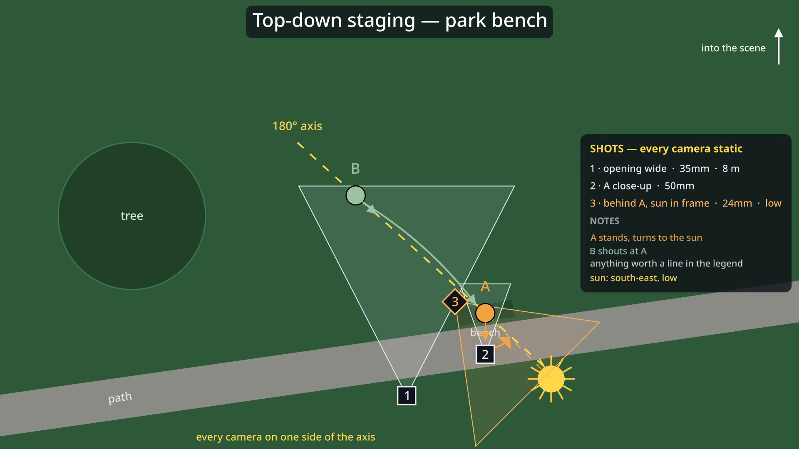
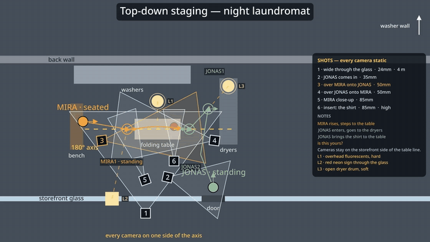

# Top-down staging

Top-down staging is an agent skill for Claude Code, Claude.ai, Cursor, Codex and other compatible agents. It is a spatial previsualization tool that turns a scene description or shot list into an animated director-facing floor plan, with characters, props, lights, shot coverage and 180° axis checks. It includes a ManimGX renderer that exports an MP4, a JSON camera report and a full-resolution finished-map PNG.





## Requirements

Only `uv` is required. On first run, `uv` selects or fetches Python 3.14 (the script requires Python 3.13 or newer), installs ManimGX, and fetches a bundled ffmpeg through `imageio-ffmpeg`; rendering runs on the CPU and does not require a GPU.

## Install

Install the agent skill with the [skills CLI](https://github.com/vercel-labs/skills):

```bash
npx skills add atakoylan125-sketch/top-down-staging
```

For Claude Code's plugin installer, add the marketplace and install the plugin:

```text
/plugin marketplace add atakoylan125-sketch/top-down-staging
/plugin install top-down-staging@top-down-staging
```

Claude.ai users can download `top-down-staging.skill` from [Releases](https://github.com/atakoylan125-sketch/top-down-staging/releases) and upload it under **Settings → Capabilities → Skills**. The skill runs Python code and needs code execution with network access to fetch ManimGX on first use; this installation path has not been verified.

For a manual Claude Code installation, copy `skills/top-down-staging` to `~/.claude/skills/`.

For custom ManimGX scenes, install the companion skill:

```bash
npx skills add academa-labs/manimgx
```

## Usage

Ask an agent: “Stage two friends arguing at a café table with window light. Make a coverage set; I did not specify shots.”

Run the bundled renderer directly:

```bash
uv run skills/top-down-staging/scripts/staging_render.py \
  examples/park-bench.json \
  -o park-bench.mp4 --quality h
```

The renderer writes `park-bench.mp4`, `park-bench.report.json` and `park-bench.last.png` beside the output. See [SKILL.md](skills/top-down-staging/SKILL.md) for the workflow, coverage rules, JSON schema and field reference.

The files in `examples/` are format demos, not installed skill templates.

## Workflow

Intake questions → plan + preview approval → render.

## How it works

The skill translates the scene into a JSON layout in metres. The bundled renderer resolves camera positions and axis warnings, animates the map with ManimGX, then conforms the result to constant 30 fps and produces a finished-map still.

## Credits and licence

Released under the MIT License. The renderer uses [ManimGX](https://github.com/academa-labs/manimgx), developed by Academa and released under the MIT License.
